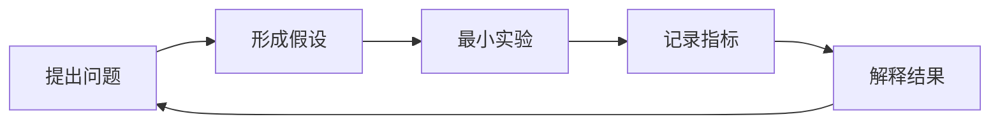

# 第 1 章：学习导览与工程环境

## 学习目标

学完本章，你应该能够：

- 说清“大模型研究”“大模型工程”和“大模型应用开发”的区别；
- 根据任务选择 CPU、单 GPU、多 GPU 或云端环境；
- 理解 Python、PyTorch、Transformers、Git、Docker 各自负责什么；
- 用版本、随机种子、配置和日志保证实验可以复现；
- 建立适合自己的“原理—实验—证据—复盘”学习循环。

## 前置知识

你需要会使用终端、理解 Python 函数与类，并知道 Git 的提交概念。不要求已经学过深度学习；遇到矩阵、导数和概率时，先理解它们在系统中的职责，再回补数学细节。

## 总：先搭建一间可复现的实验室

大模型学习最常见的误区，是一开始就下载几十 GB 权重，或者反复复制 Notebook。真正重要的是建立稳定的实验方法：知道输入是什么、改变了什么、输出如何衡量、失败如何复现。



本课程会同时使用三种尺度：

| 尺度 | 目的 | 典型设备 |
| --- | --- | --- |
| 教学尺度 | 看见算法每一步，快速试错 | CPU / 笔记本 |
| 原型尺度 | 微调真实开源模型，验证业务价值 | 单张 GPU |
| 生产尺度 | 提高吞吐、可靠性与安全性 | 多 GPU / 集群 |

不要用教学模型的效果评价生产能力，也不要用生产系统的复杂度阻碍原理学习。

## 分：工程环境的六个层次

### 1. 操作系统与计算资源

先问任务需要什么，而不是“哪张卡最好”：

- 阅读文档、数据清洗、单元测试：CPU 足够；
- 运行 1B～7B 量化模型：取决于内存/显存与上下文长度；
- LoRA/QLoRA 微调：主要受模型、精度、序列长度和 batch size 影响；
- 从零预训练：需要计算预算、网络、存储和容错设计，不能只看 GPU 数量。

显存的主要消费者可近似理解为：模型参数、梯度、优化器状态、激活值和 KV Cache。训练与推理的内存结构不同，因此“能加载”不等于“能训练”。

### 2. Python 环境

推荐每个项目使用独立虚拟环境：

```bash
python3.11 -m venv .venv
source .venv/bin/activate
python -m pip install --upgrade pip
```

检查时同时记录解释器和包版本：

```bash
python --version
python -c "import sys; print(sys.executable)"
python -m pip freeze
```

不要混用系统 Python、虚拟环境 Python 和 Notebook 内核。遇到“明明安装了却找不到包”，第一步先检查 `sys.executable`。

### 3. PyTorch：数值计算与自动微分

PyTorch 负责张量、神经网络、梯度和设备调度。下面是最小训练结构：

```python
optimizer.zero_grad()
prediction = model(inputs)
loss = criterion(prediction, targets)
loss.backward()
optimizer.step()
```

这五行对应“清空旧梯度—前向计算—衡量错误—反向传播—更新参数”。后续的预训练、SFT 和 DPO 虽然损失函数不同，但仍遵循同一骨架。

### 4. Hugging Face 生态：标准零件

常用组件及职责：

| 组件 | 职责 |
| --- | --- |
| `tokenizers` | 训练和运行高性能 Tokenizer |
| `transformers` | 模型结构、权重加载与生成 |
| `datasets` | 数据集读取、映射和流式处理 |
| `accelerate` | 单机/多设备运行抽象 |
| `peft` | LoRA 等参数高效微调 |
| `trl` | SFT、DPO 等后训练流程 |

框架能减少模板代码，但不能替你判断数据泄漏、损失异常、评测污染或模型幻觉。

### 5. Git 与实验记录

一次可复现实验至少记录：

- 代码提交版本；
- 数据版本或哈希；
- 完整配置与随机种子；
- 环境和硬件；
- 训练日志、指标与模型检查点；
- 结论，以及与预期不一致的地方。

权重和大型数据通常不直接提交到 Git。仓库保存获取方式、许可证、校验值和处理脚本。

### 6. Docker：封装运行环境

虚拟环境隔离 Python 包，Docker 进一步封装系统依赖和启动方式。它适合部署与团队复现，但不会自动解决 GPU 驱动兼容、数据版本或密钥管理问题。

> [!WARNING]
> 不要把 API Key、访问令牌、真实用户数据或私有模型地址写入镜像、Notebook、配置示例或 Git 历史。

## 工程实践：做一次环境体检

把下面清单保存到自己的学习记录中：

```text
[ ] Python 解释器来自当前虚拟环境
[ ] PyTorch 可以创建张量并完成反向传播
[ ] Git 能显示当前提交与工作区状态
[ ] 依赖版本已锁定
[ ] 实验输出目录不会被提交
[ ] 配置中没有密钥和个人数据
```

本项目的文档环境可以这样验证：

```bash
npm ci
npm run docs:dev
npm run check
```

## 贯穿案例：ShopLM 的环境决策

ShopLM 是一个电商客服教学项目。我们将任务拆成三层：

1. 在 CPU 上跑 `ShopLM Mini`，观察分词、训练和生成；
2. 在单 GPU 上用脱敏客服指令微调开源基础模型；
3. 在生产环境用推理引擎、检索和受控工具连接真实业务。

这样既能快速学习原理，又不会假装几十条样本训练出的模型可以直接服务用户。

## 常见错误

| 现象 | 常见原因 | 排查起点 |
| --- | --- | --- |
| 安装后仍无法导入 | Python 与 pip 不属于同一环境 | 检查 `sys.executable` |
| GPU 可见但训练报错 | 驱动、运行时和 PyTorch 构建不匹配 | 记录完整版本矩阵 |
| 每次结果差异很大 | 随机种子、数据顺序或非确定算子 | 固定配置并重复实验 |
| 本地成功、服务器失败 | 未锁定依赖或隐含系统依赖 | 从干净环境重建 |
| Git 仓库异常巨大 | 提交了权重、缓存或数据 | 设计存储边界与 `.gitignore` |

## 自测题

1. 为什么“模型能加载到显存”不代表它能在同一设备上训练？
2. `loss.backward()` 与 `optimizer.step()` 分别做什么？
3. 一次实验至少要记录哪些信息才能复现？
4. 虚拟环境和 Docker 解决的问题有什么不同？

## 总结

本章的核心不是安装更多软件，而是建立可复现的工程底座。接下来进入[第 2 章](/guide/02-llm-fundamentals)：看清文本如何经过 Token、Embedding、Transformer 和采样变成模型回答。

## 延伸阅读

- [PyTorch 官方教程](https://pytorch.org/tutorials/)
- [Transformers 官方文档](https://huggingface.co/docs/transformers/)
- [Docker 官方入门](https://docs.docker.com/get-started/)
