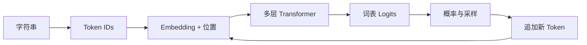

# 第 2 章：大模型核心原理

## 学习目标

学完本章，你应该能够：

- 描述文本从字符串变成 Token ID，再变成向量的过程；
- 解释自注意力为什么能让不同位置交换信息；
- 说明 Decoder-only 模型的因果掩码和下一个 Token 预测目标；
- 区分训练、推理、上下文窗口和模型参数中的知识；
- 判断 temperature、top-k、top-p 改变的是模型知识还是采样行为。

## 前置知识

理解向量、矩阵乘法和概率分布的直觉即可。公式是精确语言，但本章先把公式和工程现象对应起来。

## 总：大模型是一台条件概率机器

给定前文 Token 序列 \(x_1, x_2, \ldots, x_t\)，语言模型输出下一个 Token 的概率：

$$
P(x_{t+1} \mid x_1, x_2, \ldots, x_t)
$$

生成一段话，就是不断预测、选择、追加，再预测：



模型看似回答复杂问题，底层接口始终是“根据当前上下文产生下一个 Token 的分布”。能力来自参数规模、数据、训练目标和后训练共同塑造的内部表示。

## 分：从文本到回答

### 1. Tokenizer：模型的输入协议

Tokenizer 把文本拆成有限词表中的单元。它可能按字、词或子词切分：

```text
文本：退款什么时候到账？
Token：[退款] [什么时候] [到账] [？]
ID：   8142   3901       6620   30
```

真实切分取决于词表和算法。Tokenizer 还定义特殊 Token，例如序列开始、结束、填充和对话角色。

关键工程影响：

- 同一段文本在不同 Tokenizer 下长度不同，直接影响训练成本；
- 领域词切得太碎，模型需要更多位置组合含义；
- 更换 Tokenizer 会改变 ID 语义，不能直接沿用原模型 Embedding；
- “上下文 8K”通常指 Token 数，不是汉字数。

### 2. Embedding：把离散 ID 变成连续向量

Embedding 表本质上是一个可训练矩阵。每个 Token ID 查到一行向量。相似 Token 的向量不必一开始相似，而是在训练中因相似上下文逐渐形成结构。

模型还需要位置信息，否则“用户拒绝退款”和“退款拒绝用户”只是一组相同 Token。现代模型常使用旋转位置编码（RoPE）等方式把相对位置信息融入注意力。

### 3. 自注意力：让每个位置读取上下文

每个输入向量投影成 Query、Key、Value：

$$
\mathrm{Attention}(Q,K,V)=\mathrm{softmax}\left(\frac{QK^T}{\sqrt{d_k}} + M\right)V
$$

- Query：当前位置想找什么；
- Key：每个位置能用什么特征被匹配；
- Value：匹配后真正取回的信息；
- \(M\)：掩码，Decoder 中禁止看到未来 Token。

多头注意力允许模型同时学习不同关系，例如指代、语法、时间和业务实体。注意力之后还有前馈网络、残差连接与归一化，共同构成 Transformer Block。

### 4. Decoder-only 与因果掩码

在训练句子“退款已经到账”时，模型可以并行计算多个预测：

| 已知前文 | 预测目标 |
| --- | --- |
| `<BOS>` | 退款 |
| `<BOS> 退款` | 已经 |
| `<BOS> 退款 已经` | 到账 |

因果掩码保证每个位置只能读取自己和左侧，避免提前看到答案。训练可以并行，推理必须逐 Token 生成；KV Cache 会复用历史位置的 Key 和 Value，避免每一步全部重算。

### 5. 预训练损失

模型输出整个词表的 Logits，softmax 转成概率。交叉熵损失惩罚正确 Token 概率过低：

$$
\mathcal{L}=-\frac{1}{N}\sum_{i=1}^{N}\log P(x_i\mid x_{<i})
$$

损失下降说明模型更会预测当前数据分布，不自动等价于事实更准确、推理更可靠或业务更安全。因此必须准备独立验证集和下游评测。

### 6. 从 Logits 到文本

常见解码参数：

| 参数 | 作用 | 风险 |
| --- | --- | --- |
| greedy | 总选最高概率 | 稳定但可能重复、僵硬 |
| temperature | 缩放概率尖锐程度 | 太高会随机，太低会单一 |
| top-k | 只在概率最高的 k 个中选择 | k 太小损失多样性 |
| top-p | 在累计概率阈值内选择 | 输出随分布动态变化 |

这些参数改变“怎么选”，不会给模型补充新知识。事实问题需要检索、工具或更可靠的数据与训练，而不是简单调高 temperature。

### 7. Scaling：为什么变大常常有效

扩大参数、数据和计算通常能降低训练损失并涌现更强能力，但三者必须匹配。只增加参数而数据不足，会浪费算力甚至过拟合；只增加低质量数据，也可能放大噪声。

生产决策还要同时考虑：数据许可、训练稳定性、推理延迟、显存、能耗和可维护性。“更大”是一种资源选择，不是默认答案。

## 工程实践：跟踪一次形状变化

假设 batch 为 2、序列长度 8、隐藏维度 16、词表大小 100：

```text
Token IDs       [2, 8]
Embedding       [2, 8, 16]
Q / K / V       [2, heads, 8, head_dim]
Attention 输出  [2, 8, 16]
Logits          [2, 8, 100]
Targets         [2, 8]
```

调试模型时，先检查形状、dtype、device 和掩码，再怀疑复杂算法。大量错误来自这四项不一致。

## 贯穿案例：ShopLM 如何回答退款问题

用户输入“退款什么时候到账？”后：

1. Tokenizer 转成 ID；
2. Embedding 和位置机制构造连续表示；
3. 多层注意力聚合“退款”“什么时候”“到账”的关系；
4. 最后一层输出下一个 Token 概率；
5. 解码器生成“退款到账时间取决于……”；
6. 如果需要真实订单状态，系统必须调用退款查询工具，而不是依赖参数猜测。

模型原理解释了语言生成，业务系统负责实时事实和权限边界。

## 常见错误

- 把 Token 当成汉字或单词：它由具体 Tokenizer 决定。
- 认为上下文越长越好：长度会增加计算和注意力分散风险。
- 用训练集损失证明模型可用：它只能证明拟合程度。
- 把采样随机性当成模型学到了新知识。
- 认为注意力权重就是完整、可信的因果解释。

## 自测题

1. 为什么更换 Tokenizer 后不能直接复用原 Embedding？
2. 因果掩码在训练中防止了什么？
3. KV Cache 为什么能加速自回归生成？
4. temperature 改变了模型参数吗？
5. 训练损失下降为什么不能代替业务评测？

## 总结

大模型把离散文本转换成向量，通过带因果约束的 Transformer 学习下一个 Token 分布，再通过解码策略逐步生成文本。掌握这条主线后，我们进入[第 3 章](/guide/03-llm-lifecycle)，把模型放进真实的数据、训练、评测和部署系统。

## 延伸阅读

- [Attention Is All You Need](https://arxiv.org/abs/1706.03762)
- [The Illustrated Transformer](https://jalammar.github.io/illustrated-transformer/)
- [Hugging Face NLP Course](https://huggingface.co/learn/nlp-course/)
