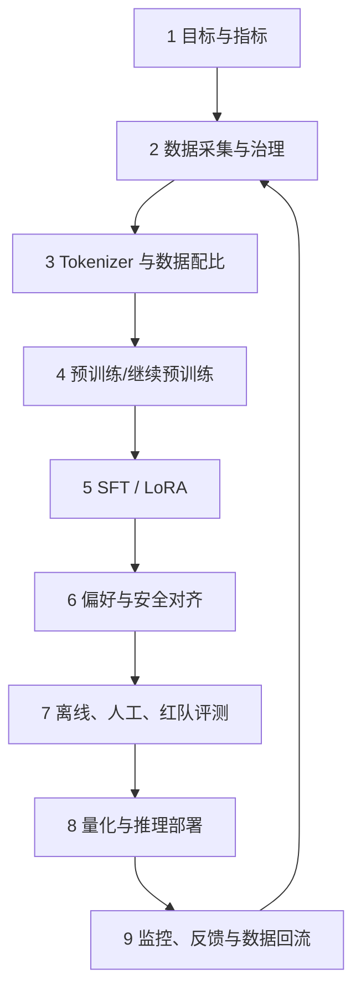
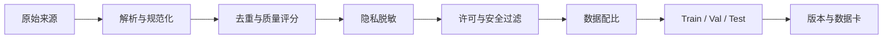
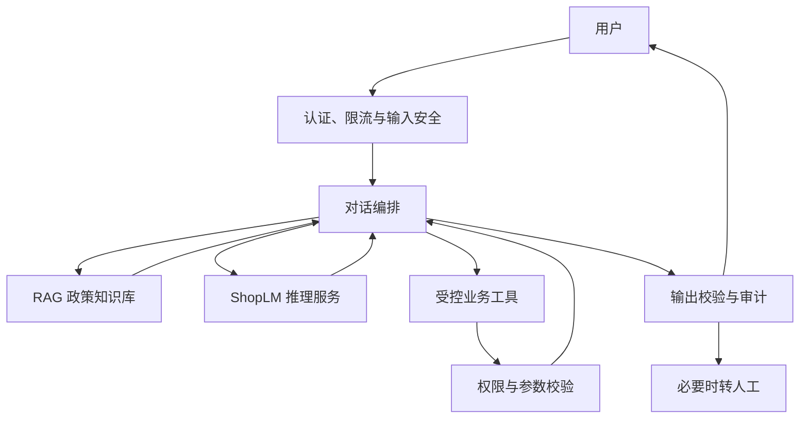

# 第 3 章：大模型全链路工程

## 学习目标

学完本章，你应该能够：

- 画出从需求定义到线上数据回流的大模型工程闭环；
- 区分预训练、SFT、参数高效微调、偏好对齐和 RAG 的职责；
- 为业务模型定义数据、能力、安全、性能和成本指标；
- 解释模型权重、知识库、工具系统和安全网关如何协作；
- 为一次模型迭代设计可复现的训练、评测与灰度方案。

## 前置知识

建议先完成[第 2 章](/guide/02-llm-fundamentals)，理解 Decoder-only 模型、训练损失和自回归生成。

## 总：训练模型只是系统闭环的一部分

一个可用的大模型产品由数据、模型和系统共同构成：



本章用虚构项目 **ShopLM** 贯穿全链路：它是一个 7B 级电商客服模型，需要解释规则、辅助订单查询、生成规范回复，并在越权或不确定时转人工。

## 分：ShopLM 的九个工程阶段

### 1. 定义目标：先写验收标准

不要从“选什么模型”开始，而要从用户任务和失败成本开始。

| 维度 | ShopLM 示例指标 |
| --- | --- |
| 业务能力 | 售后政策问答准确率、问题解决率 |
| 事实可靠性 | 不编造订单、物流和退款状态 |
| 工具能力 | 工具选择、参数和结果解释正确率 |
| 安全 | 隐私泄露、越权调用和攻击成功率 |
| 体验 | 首 Token 延迟、完整响应延迟、转人工率 |
| 成本 | 每千次对话 GPU 时间与调用成本 |

同时建立不做清单：模型无权直接批准赔偿，无权查看其他用户订单，也不能把内部策略当作公开承诺。

### 2. 数据工程：质量、合法性与可追踪

ShopLM 的数据分三层：

1. 通用语料：提供语言、知识与推理基础；
2. 电商领域语料：商品说明、平台政策、业务术语；
3. 后训练数据：指令回答、工具轨迹、偏好排序和安全样本。

处理流水线：



关键规则：

- 保存来源、许可证、处理版本和哈希，不只保存最终文本；
- 按用户、时间或来源隔离测试集，防止近重复泄漏；
- 真实客服记录先做授权、最小化和不可逆脱敏；
- 低质量合成数据不能无限自我复制，必须抽检并与真实任务对齐。

### 3. Tokenizer：成本与领域表达的共同接口

从零训练模型时，需要用代表性语料训练 Tokenizer，并检查中文、数字、金额、订单号和领域词的切分效率。继续训练已有模型时，通常保留原 Tokenizer；新增 Token 会改变词表和 Embedding，需要初始化与额外训练。

评估不只看词表大小，还看：每字符 Token 数、未知/异常字符、领域术语碎片率和不同语言公平性。

### 4. 预训练与继续预训练

预训练通过下一个 Token 预测获得通用能力。工程循环是：

```text
读取批次 → 前向传播 → 计算交叉熵 → 反向传播
→ 梯度裁剪 → 优化器更新 → 学习率调度 → 记录与保存
```

需要监控训练/验证损失、学习率、梯度范数、吞吐、显存、数据位置和数值异常。检查点至少包含模型、优化器、调度器、随机状态和数据游标，否则“恢复”可能改变训练轨迹。

ShopLM 更现实的路线是选择许可兼容的基础模型，用经过治理的电商语料进行继续预训练，而不是为单一业务从零训练 7B 模型。

### 5. SFT、LoRA 与 QLoRA

监督微调（SFT）用“指令—理想回答”教授对话格式、任务步骤和表达规范：

```json
{
  "system": "你是电商客服。不得编造订单状态。",
  "user": "退款为什么还没到账？",
  "assistant": "到账时间取决于支付渠道。请提供退款发起时间和支付方式，我可以进一步核对。"
}
```

- 全参数 SFT：更新所有权重，资源高、能力调整充分；
- LoRA：训练插入的低秩矩阵，成本低、便于保存多个适配器；
- QLoRA：量化基础权重并训练 LoRA，进一步降低显存占用。

参数高效不代表数据可以粗糙。数据格式、目标 Token 掩码、长度分布和样本配比往往比调 Rank 更先决定结果。

### 6. 偏好与安全对齐

同一问题生成多个回答，让标注者选择更符合标准的结果：

```text
问题：退款怎么还没到账？
A：等着就行。
B：说明渠道差异，询问时间和支付方式，并提供查询下一步。
偏好：B > A
```

DPO 直接从 chosen/rejected 对学习偏好；RLHF 通常先训练奖励模型，再用强化学习优化策略。选择方法前要先定义清晰、可一致执行的标注规范。

安全样本覆盖隐私、越权、诈骗、提示注入、内部信息和高风险承诺。但模型拒答不是最终权限控制：后端必须验证身份、资源归属、工具参数和操作权限。

### 7. 评测：证明改动解决了目标问题

建立分层评测矩阵：

| 层级 | 关注点 | 示例 |
| --- | --- | --- |
| 模型 | 知识、推理、指令遵循 | 固定离线集、回归集 |
| 业务 | 是否解决真实任务 | 售后政策、退款解释 |
| 工具 | 调用是否正确 | 工具名、参数、结果引用 |
| 安全 | 能否抵抗攻击 | 隐私、越权、提示注入 |
| 系统 | 性能与可靠性 | 延迟、吞吐、错误率、成本 |

评测集要版本化；记录模型、提示、知识库、工具和解码配置。只比较总分会掩盖关键退化，应按场景和失败类型切片。

### 8. 推理、RAG 与工具部署

生产架构不是“用户直接访问模型”：



RAG 适合频繁变化、可追溯的政策知识；工具适合订单、物流等实时结构化事实；模型负责理解、规划和表达。量化、批处理、KV Cache、并行和推测解码用于改善成本与延迟，但必须回归验证质量。

### 9. 灰度、监控与数据回流

上线顺序可以是内部测试、影子流量、1% 灰度、分阶段扩量。监控包括：

- 请求量、延迟、吞吐、错误率和 GPU 利用率；
- 问题解决率、转人工率、用户反馈和工具成功率；
- 幻觉、安全事件、策略违规和数据漂移；
- 模型、提示、知识库和工具版本。

数据回流必须再次经过授权、脱敏、去重、标注和审查。线上错误不能未经治理直接成为训练真相。

## 工程实践：把每次迭代当成一次受控实验

ShopLM 的一次迭代应留下：

```text
变更假设：增加“审核完成 ≠ 已到账”样本可减少状态混淆
数据版本：support-sft-v1.3
模型版本：shoplm-7b-sft-042
基线版本：shoplm-7b-sft-041
离线结果：目标切片 +7.4%，总体无显著退化
安全回归：通过
灰度策略：5% 流量，24 小时
回滚条件：投诉率或错误工具调用超过阈值
```

没有基线、切片和回滚条件的“升级”，只是一次不可解释的替换。

## 动手实验：ShopLM Mini

[ShopLM Mini](/labs/shoplm-mini) 用极小语料和纯 Python 实现一个字符级二元语言模型。它不是 Transformer，也不追求可用效果；它刻意保留全链路的接口：

```text
原始语料 → 数据校验 → Tokenizer → 预训练 → 指令微调
→ 生成 → 固定评测 → 检查点 → 可复现报告
```

先在几秒内看见闭环，再把每个简化模块替换为生产组件。

## 常见错误

| 错误 | 为什么危险 | 正确做法 |
| --- | --- | --- |
| 先选模型再定义任务 | 指标和成本失去依据 | 先写任务、失败成本和验收集 |
| 用 RAG 代替所有训练 | 语气、格式和行为未必改善 | 按知识、行为、实时事实分工 |
| 测试集混入训练 | 得到虚假高分 | 近重复检测与隔离策略 |
| 只看平均分 | 关键场景退化被掩盖 | 按业务与风险切片 |
| 让模型承担权限 | 提示攻击可绕过约束 | 后端做确定性鉴权 |
| 自动回流所有对话 | 放大隐私、攻击和错误 | 治理后进入候选数据池 |

## 自测题

1. 继续预训练和 SFT 分别主要改变什么？
2. 政策文档、订单状态和客服语气分别更适合由什么机制承载？
3. 为什么模型学会拒绝越权请求仍然不够？
4. 一个可恢复训练检查点为什么要包含数据游标和随机状态？
5. 新模型总体分数更高，为什么仍可能不能上线？

## 总：全链路的本质是证据闭环

大模型工程不是线性“训练完成即结束”，而是目标、数据、训练、评测、部署和反馈相互约束的循环。预训练决定能力底座，后训练塑造行为，RAG 与工具连接外部事实，安全系统约束权限，评测和监控为每次变更提供证据。

现在进入 [ShopLM Mini 实验](/labs/shoplm-mini)，亲手跑通第一个最小闭环。

## 延伸阅读

- [Hugging Face LLM Course](https://huggingface.co/learn/llm-course/)
- [PEFT 官方文档](https://huggingface.co/docs/peft/)
- [TRL 官方文档](https://huggingface.co/docs/trl/)
- [vLLM 官方文档](https://docs.vllm.ai/)
