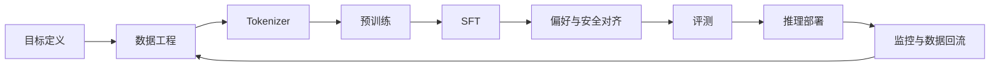

## 你最终会获得什么？

完成本项目后，你不只会“调用一个模型”，而是能够解释并动手验证下面这条完整链路：

  
<strong>第一阶段 · 看懂</strong> 建立 Token、注意力、训练目标和推理过程的统一心智模型。

  
<strong>第二阶段 · 跑通</strong> 在 CPU 上完成一个小模型从数据到生成的最小闭环。

  
<strong>第三阶段 · 放大</strong> 理解小实验如何映射到多 GPU、服务化、安全和持续迭代。

> [!TIP]
> 如果你只有 Python 基础，从[第 1 章](/guide/01-getting-started)开始；如果已经做过模型调用，可以先阅读[第 3 章](/guide/03-llm-lifecycle)建立全局视角。

## V1 内容状态

| 内容 | 状态 | 产出 |
| --- | --- | --- |
| 学习导览与工程环境 | ✅ 已发布 | 可复现的本地工具链 |
| 大模型核心原理 | ✅ 已发布 | 从 Token 到生成的心智模型 |
| 大模型全链路工程 | ✅ 已发布 | ShopLM 端到端架构方案 |
| ShopLM Mini 实验 | ✅ 已发布 | CPU 可运行的最小训练闭环 |
| 后续专题章节 | 🛠️ Roadmap | 逐章审校后发布 |

下一步：[查看完整课程地图 →](/roadmap/)
