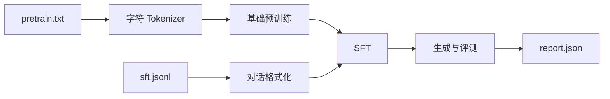

# ShopLM Mini：CPU 全链路实验

## 学习目标

这个实验不追求客服效果，而是让你在普通 CPU 上看见一次完整、可复现的模型迭代。完成后你将获得训练日志、基础模型、SFT 模型、评测报告和生成样例。

## 前置知识

完成[第 2 章](/guide/02-llm-fundamentals)和[第 3 章](/guide/03-llm-lifecycle)，本机安装 Python 3.11。

## 总：先缩小规模，不删除关键阶段

ShopLM Mini 使用字符级 Tokenizer、单层因果自注意力和极小隐藏维度。所有语料均为项目自带的虚构示例，不包含真实用户信息。



## 分：运行实验

### 1. 创建环境

从仓库根目录执行：

```bash
python3.11 -m venv .venv
source .venv/bin/activate
python -m pip install --upgrade pip
python -m pip install -r examples/shoplm-mini/requirements.txt
```

### 2. 运行完整流水线

```bash
python examples/shoplm-mini/run_pipeline.py --steps 80 --output artifacts/shoplm-mini
```

脚本将：

1. 校验语料格式并建立字符词表；
2. 用领域文本执行下一个 Token 预训练；
3. 将客服问答格式化后继续执行 SFT；
4. 在固定验证文本上计算损失和困惑度；
5. 保存并重新加载模型，验证检查点一致性；
6. 从固定提示生成样例，并写出 JSON 报告。

> [!NOTE]
> 极小模型和极少语料可能生成重复或不通顺文本，这是预期现象。实验验收的是链路、接口与可复现性，不是业务质量。

### 3. 运行自动测试

```bash
python -m unittest discover -s examples/shoplm-mini/tests -v
```

测试覆盖 Tokenizer 往返、前向形状、训练损失、检查点保存/加载和生成。

### 4. 阅读结果

重点观察：

- `pretrain_start_loss` 与 `pretrain_end_loss`；
- `sft_start_loss` 与 `sft_end_loss`；
- 验证集 `loss` 和 `perplexity`；
- 相同随机种子下报告是否一致；
- 改动层数、上下文长度或数据后，质量与耗时如何变化。

## 与生产系统的映射

| ShopLM Mini | 生产级替代 |
| --- | --- |
| 项目内虚构文本 | 许可清晰、治理和版本化的大规模数据湖 |
| 字符级词表 | BPE / Unigram 等标准 Tokenizer |
| 单层微型 Decoder | 多层、数十亿参数模型 |
| 单进程 CPU | 数据/张量/流水线并行集群 |
| 全参数 SFT | 全参数 SFT、LoRA 或 QLoRA |
| 固定验证损失 | 能力、业务、安全、人工和系统评测 |
| 本地检查点 | 分布式检查点、模型注册表和制品存储 |
| 命令行生成 | 推理引擎、网关、RAG、工具与监控 |

## 常见错误

- 把训练语料和验证文本混在一起，得到虚假的低损失；
- 只保存模型参数，忘记词表和模型配置；
- 用生成样例的“观感”代替固定评测；
- 改多个变量后无法判断是哪项带来变化；
- 把教学实验结果包装成可上线模型。

## 自测题

1. 为什么词表必须与模型检查点一起保存？
2. 预训练和 SFT 在这个实验中使用了相同的什么目标？数据格式又有什么不同？
3. 为什么固定随机种子仍不能保证所有硬件上的逐位一致？
4. 如果训练损失下降、验证损失上升，可能发生了什么？

## 总结

这个实验把“大模型全链路”压缩成一个能在几分钟内理解和修改的工程闭环。下一步不要盲目放大参数；先任选一个环节替换成真实组件，并用相同评测比较变化。
