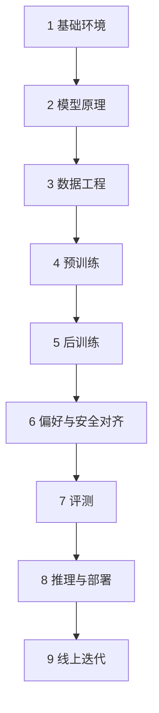

# 九部分课程地图

## 总：先建立路线，再逐段攻克

大模型工程不是“学会一个框架”或“跑通一次微调”。这套课程按生产系统的因果顺序组织：先理解模型，再掌握数据和训练，最后处理评测、部署与迭代。

## 分：九部分及学习产出

| 部分 | 核心问题 | 可验证产出 | 状态 |
| --- | --- | --- | --- |
| 1. 基础环境 | 工程工具如何协作？ | Python、PyTorch、Git、容器环境 | ✅ V1 |
| 2. 模型原理 | 模型如何把文本变成概率？ | 手算注意力、解释训练与生成 | ✅ V1 |
| 3. 数据工程 | 如何获得合法、干净、可追踪的数据？ | 清洗、去重、脱敏、配比流水线 | 🛠️ Roadmap |
| 4. 预训练 | 如何稳定地学习下一个 Token？ | 小模型训练、检查点与恢复 | 🛠️ Roadmap |
| 5. 后训练 | 如何让基础模型遵循指令？ | SFT、LoRA、QLoRA 实验 | 🛠️ Roadmap |
| 6. 偏好与安全 | 如何定义“更好的回答”？ | DPO 数据、拒答与红队集 | 🛠️ Roadmap |
| 7. 评测 | 如何证明模型真的变好？ | 离线、人工与系统评测矩阵 | 🛠️ Roadmap |
| 8. 推理与部署 | 如何低成本、稳定地提供服务？ | 量化模型、API、容器和压测 | 🛠️ Roadmap |
| 9. 线上迭代 | 如何从失败案例持续学习？ | 监控、数据回流、版本发布 | 🛠️ Roadmap |

### 推荐学习节奏

- 每周投入 6～8 小时：预计 12～16 周完成全路线。
- 每一部分遵循“读原理 → 跑实验 → 改参数 → 写复盘”。
- 不以“代码没有报错”为完成标准，以能解释结果、定位失败为标准。

## 总：用作品证明能力

课程的终点不是读完文档，而是交付一个可复现、可评测、可部署的模型工程项目。V1 先从 [ShopLM Mini 实验](/labs/shoplm-mini) 建立最小闭环，再逐步替换为真实数据、标准 Tokenizer、预训练模型和生产推理服务。
